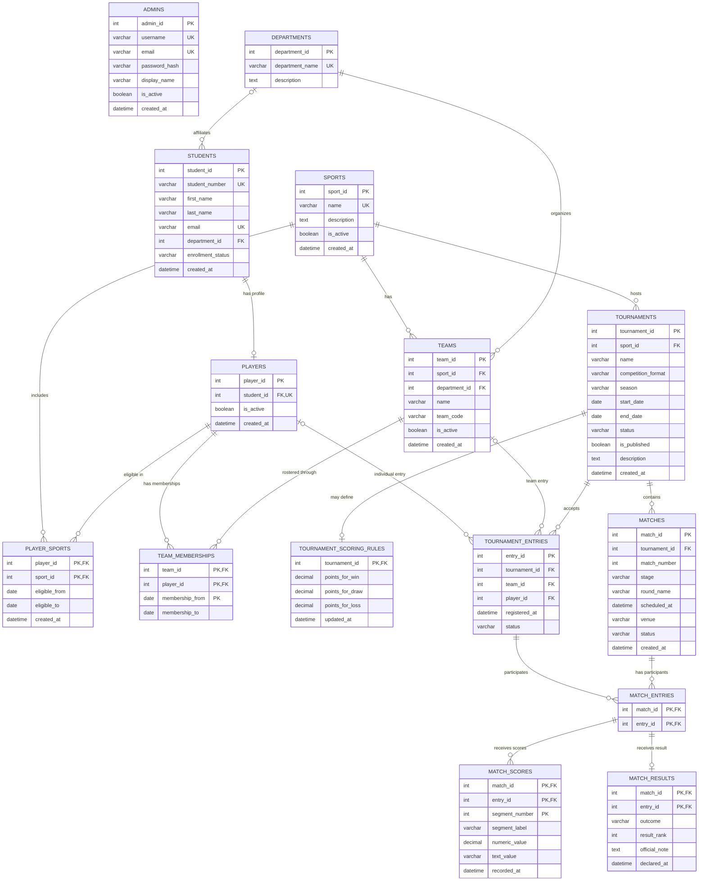

# Phase 1: Requirements and Database Design

## 1. Requirement specification

### Functional requirements

- Authenticate administrators using a unique login identifier and a securely
  stored password hash.
- Maintain departments, sports, student records, player profiles, and the
  sports in which each player is eligible to compete.
- Create teams for a single sport and maintain their player rosters over time.
- Create tournaments for a sport and select whether each tournament is
  individual or team-based.
- Register eligible players or teams as tournament entries.
- Schedule matches between entries already registered in the same tournament.
- Record multi-part or single-part scores, declare match outcomes, and retain
  the official result for each participating entry.
- Calculate standings and reports from tournament entries, scores, and results
  using database queries. Do not persist a separately maintained standings
  table.
- Let unauthenticated public users browse active sports and teams, and read
  published tournaments and their registered entries, fixtures, scores,
  results, winners, and standings.
- Restrict public tournament-related data to published tournaments; publication
  is separate from whether a record is operationally active.
- Public endpoints must filter tournament records on `is_published = TRUE`
  and apply the documented active-state filters to sports and teams.
- Restrict administrative writes to authenticated administrators.

### Non-functional requirements

- Use MySQL as the authoritative relational data store, with foreign keys,
  unique constraints, checks, defaults, and indexes.
- Keep personal data and administrator password hashes protected; never store
  plaintext passwords.
- Preserve referential integrity and use transactions when a workflow updates
  multiple related records.
- Keep the model normalized and avoid storing values that can be derived
  reliably from other records.
- Support both individual and team tournaments and accommodate different
  sports without cricket-specific columns or assumptions.
- Make public queries efficient with indexes on common foreign keys, statuses,
  dates, and lookup keys.
- Keep the database design understandable, auditable, and suitable for
  parameterized REST API operations.

### User operations

| User | Operations |
|---|---|
| Admin | Sign in; manage departments, sports, and students; create player profiles and sport eligibility; create department-based teams and manage rosters; create tournaments and scoring rules; register entries; schedule matches; record scores and results; publish tournaments; review standings and reports. |
| Public | Browse departments and active sports and teams; view published tournaments and their registered participants; see their upcoming/live matches, scores, results, winners, and standings. Public access is read-only. |

### Application workflow

1. An administrator signs in. Credentials are checked against the stored
   password hash.
2. The administrator defines departments and sports, then records students
   and optionally associates them with a department. A student who competes
   receives one player profile and one or more sport-eligibility records.
3. For a team sport, the administrator creates a team under a sport and
   department, then adds eligible players to its roster. Membership dates
   preserve roster history.
4. The administrator creates a tournament for a sport and chooses its format:
   team or individual. Team tournaments can have points rules for wins, draws,
   and losses.
5. Eligible teams or players are registered as tournament entries.
6. Matches are scheduled using entries from that same tournament. Scores can
   be recorded in one or more segments (for example, periods or sets).
7. Once the match is decided, an official result is recorded for each
   participant. Changes to finalized results should be performed as an
   authorized correction within a transaction.
8. The administrator explicitly publishes a tournament when its public
   information is ready. SQL queries aggregate results to produce standings,
   reports, and public views. Public endpoints list active sports and teams,
   but return tournament-specific entries, fixtures, scores, results, winners,
   and standings only when the associated tournament is published.

## 2. Entities and attributes

Notation: `PK` = primary key, `FK` = foreign key, `UQ` = unique constraint,
`NN` = not null. Attributes below describe the logical model; physical MySQL
types and constraints are implemented in `schema.sql`.

### Admins

- `admin_id` (PK)
- `username` (NN, UQ)
- `email` (NN, UQ)
- `password_hash` (NN)
- `display_name` (NN)
- `is_active` (NN, default true)
- `created_at` (NN, default current timestamp)

Store a one-way password hash, never a password or reversible credential.

### Sports

- `sport_id` (PK)
- `name` (NN, UQ)
- `description` (nullable)
- `is_active` (NN, default true)
- `created_at` (NN, default current timestamp)

### Departments

- `department_id` (PK)
- `department_name` (NN, UQ)
- `description` (nullable)

Departments provide a normalized reference for student affiliations and
department-based teams.

### Students

- `student_id` (PK)
- `student_number` (NN, UQ)
- `first_name` (NN)
- `last_name` (NN)
- `email` (nullable, UQ when present)
- `department_id` (nullable, FK to `Departments.department_id`)
- `enrollment_status` (NN, default active)
- `created_at` (NN, default current timestamp)

### Players

- `player_id` (PK)
- `student_id` (NN, FK to `Students.student_id`, UQ)
- `is_active` (NN, default true)
- `created_at` (NN, default current timestamp)

The one-to-one student/player relationship keeps student identity details in
one place while allowing students who are not players.

### Player_Sports

- `player_id` (PK part, FK to `Players.player_id`)
- `sport_id` (PK part, FK to `Sports.sport_id`)
- `eligible_from` (NN)
- `eligible_to` (nullable, CHECK `eligible_to IS NULL OR eligible_to >= eligible_from`)
- `created_at` (NN, default current timestamp)

This is the eligibility/participation association that permits one player to
compete in multiple sports.

### Teams

- `team_id` (PK)
- `sport_id` (NN, FK to `Sports.sport_id`)
- `department_id` (NN, FK to `Departments.department_id`)
- `name` (NN)
- `team_code` (nullable)
- `is_active` (NN, default true)
- `created_at` (NN, default current timestamp)
- UQ (`sport_id`, `department_id`, `name`)

A team belongs to exactly one sport and one department. A team name must be
unique within its sport and department, but may be reused by a different
department or sport.

### Team_Memberships

- `team_id` (PK part)
- `player_id` (PK part)
- `membership_from` (PK part, NN)
- `membership_to` (nullable, CHECK `membership_to IS NULL OR membership_to >= membership_from`)
- FK (`team_id`) to `Teams.team_id`
- FK (`player_id`) to `Players.player_id`
- Validate that the player is eligible for the team's sport through
  `Player_Sports`, using a trigger or transactional check

Membership dates allow roster history. A player may be on teams in different
sports; overlapping active memberships in the same sport must be prevented by
a trigger or a transactional service check.

### Tournaments

- `tournament_id` (PK)
- `sport_id` (NN, FK to `Sports.sport_id`)
- `name` (NN)
- `competition_format` (NN; `team` or `individual`)
- `season` (NN)
- `start_date` (NN)
- `end_date` (NN, CHECK `end_date >= start_date`)
- `status` (NN, default planned; planned, registration, in progress, completed,
  cancelled)
- `is_published` (NN, BOOLEAN, default false)
- `description` (nullable)
- `created_at` (NN, default current timestamp)
- UQ (`sport_id`, `name`, `season`)

`status` describes the tournament's operational lifecycle. `is_published`
controls whether public endpoints may expose the tournament and its related
entries, matches, scores, results, winners, and standings. A tournament can be
active but unpublished, or published and later cancelled; publication must
not be inferred from `status`.

Sports and teams use their existing `is_active` fields for operational
availability; they do not have a separate publication flag in this design.
Public sport and team catalog endpoints return active records. Tournament
endpoints and all tournament-specific information require
`is_published = TRUE`; the related sport/team must also be active where
applicable. Administrators may still access unpublished or inactive records.

### Tournament_Scoring_Rules

- `tournament_id` (PK, FK to `Tournaments.tournament_id`)
- `points_for_win` (NN, default 3)
- `points_for_draw` (NN, default 1)
- `points_for_loss` (NN, default 0)
- `updated_at` (NN, default current timestamp)

Optional one-to-one rules for team tournament standings. Individual
tournaments may instead rank entries by their declared result. Rules should
not be changed after results are finalized unless the affected standings are
recomputed. Each points value must have a database `CHECK` constraint
requiring it to be greater than or equal to zero.

### Tournament_Entries

- `entry_id` (PK)
- `tournament_id` (NN)
- `team_id` (nullable)
- `player_id` (nullable)
- `registered_at` (NN, default current timestamp)
- `status` (NN, default registered; registered, withdrawn, disqualified)
- FK (`tournament_id`) to `Tournaments.tournament_id`
- FK (`team_id`) to `Teams.team_id`
- FK (`player_id`) to `Players.player_id`
- Validate participant sport and tournament format using a trigger or
  transaction-level check
- UQ (`tournament_id`, `team_id`) when team entry is present
- UQ (`tournament_id`, `player_id`) when individual entry is present
- Check: exactly one of `team_id` and `player_id` is non-null

The tournament format must agree with the populated entry type: team
tournaments accept teams; individual tournaments accept players. Enforce this
cross-table rule in database triggers or a validated transaction because a
row-level check cannot inspect the tournament row. `entry_id` is the primary
key and therefore a candidate key by itself. (`tournament_id`, `entry_id`) is
a superkey, not a candidate key, because it contains the already unique
`entry_id`. The exactly-one-participant check is a row-level database
constraint: either `team_id` is non-null and `player_id` is null, or vice
versa.

### Matches

- `match_id` (PK)
- `tournament_id` (NN, FK to `Tournaments.tournament_id`)
- `match_number` (NN)
- `stage` (nullable; for example, group or final)
- `round_name` (nullable)
- `scheduled_at` (nullable)
- `venue` (nullable)
- `status` (NN, default scheduled; scheduled, live, completed, postponed,
  cancelled)
- `created_at` (NN, default current timestamp)
- UQ (`tournament_id`, `match_number`)
- (`match_id`, `tournament_id`) is a superkey, not a candidate key, because
  `match_id` is already the primary key.

### Match_Entries

- `match_id` (PK part)
- `entry_id` (PK part)
- FK (`match_id`) to `Matches.match_id`
- FK (`entry_id`) to `Tournament_Entries.entry_id`
- Validate that the entry and match share a tournament using a trigger or
  transaction-level check

This association supports matches with two or more participants, covering
head-to-head games as well as multi-entrant individual heats. A match must
have the sport-appropriate minimum number of entries before it is started.

### Match_Scores

- `match_id` (PK part)
- `entry_id` (PK part)
- `segment_number` (PK part, NN; positive)
- `segment_label` (nullable; for example, set or period)
- `numeric_value` (nullable)
- `text_value` (nullable)
- `recorded_at` (NN, default current timestamp)
- FK (`match_id`, `entry_id`) to `Match_Entries`
- Check: exactly one of `numeric_value` and `text_value` is present

Multiple score segments support sport-specific score progressions without
adding columns for individual sports. The selected convention (numeric or
text) should be consistent within a tournament.

### Match_Results

- `match_id` (PK part)
- `entry_id` (PK part)
- `outcome` (NN; for example, win, draw, loss, placed, forfeit, did not start,
  disqualified)
- `result_rank` (nullable; positive when present)
- `official_note` (nullable)
- `declared_at` (NN, default current timestamp)
- FK (`match_id`, `entry_id`) to `Match_Entries`

Results are per match participant, allowing a draw, a winner/loser pair, or
placements in an individual event. Ranks may be tied: multiple participants
in the same match may share a rank. Finalizing a match should create a result
for every participant and update its match status within one transaction.

## 3. Relationships and participation

| Relationship | Cardinality and participation |
|---|---|
| Departments — Students | One-to-many. A student may belong to zero or one department; a department may have zero or many students. `Students.department_id` is nullable and references one department when present. |
| Departments — Teams | One-to-many. Each team must belong to exactly one department; a department may have zero or many teams. |
| Students — Players | One-to-zero-or-one. A player profile must belong to exactly one student; a student may have no player profile. Enforced by `Players.student_id` being both `NOT NULL` and `UNIQUE`. |
| Players — Sports | Many-to-many through `Player_Sports`. A player may be eligible for multiple sports; a sport may have multiple eligible players. Each association references one existing player and one existing sport. |
| Sports — Teams | One-to-many. Each team must belong to exactly one sport; a sport may have no teams or many teams. |
| Teams — Players | Many-to-many over time through `Team_Memberships`. A team has multiple membership records; a player can have multiple historical or cross-sport team memberships. Each membership must match the player's eligibility sport to the team's sport. |
| Sports — Tournaments | One-to-many. Each tournament must belong to one sport; a sport may have zero or many tournaments. |
| Tournaments — Tournament_Scoring_Rules | One-to-zero-or-one. A tournament can have no points rules or one points-rules row; each rules row belongs to one tournament. |
| Tournaments — Tournament_Entries | One-to-many. Each entry belongs to exactly one tournament; a tournament can have zero or many entries. Each entry references either one team or one eligible player, according to tournament format. |
| Teams/Players — Tournament_Entries | Each team or player can have entries in many tournaments. A given team/player can be entered at most once in the same tournament, enforced by the appropriate unique key. |
| Tournaments — Matches | One-to-many. Each match belongs to exactly one tournament; a tournament can have zero or many matches. |
| Matches — Tournament_Entries | Many-to-many through `Match_Entries`. Every match participant must already be an entry in that same tournament. A match may have multiple entries; a tournament entry may participate in multiple matches. |
| Match_Entries — Match_Scores | One-to-many. A participant in a match may have one score row per score segment. Each score must belong to a participant in that match. |
| Match_Entries — Match_Results | One-to-zero-or-one. An entry may not yet have a result while a match is pending; a finalized match should have exactly one result per participant. |
| Admins — managed records | Administrative actions are authorized by the application. Actor/audit foreign keys are not included in this initial domain schema; add an audit log if change history is required. |

There are no required direct one-to-one entities besides the optional
student/player profile and optional tournament scoring rules. The
many-to-many relationships are explicit association tables rather than
repeating lists or duplicated columns.

## 4. ER diagram



Membership and tournament entry sport/format consistency are cross-table
constraints validated by triggers or transactions. The schema avoids copying
sport or tournament keys into association tables solely to express those
rules. Each tournament entry references either a team or a player, never both.

## 5. Relational schema

The following is a readable logical schema, not executable SQL.

```text
Admins(
  admin_id PK,
  username UQ NOT NULL,
  email UQ NOT NULL,
  password_hash NOT NULL,
  display_name NOT NULL,
  is_active NOT NULL DEFAULT true,
  created_at NOT NULL
)

Sports(
  sport_id PK,
  name UQ NOT NULL,
  description,
  is_active NOT NULL DEFAULT true,
  created_at NOT NULL
)

Departments(
  department_id PK,
  department_name UQ NOT NULL,
  description NULL
)

Students(
  student_id PK,
  student_number UQ NOT NULL,
  first_name NOT NULL,
  last_name NOT NULL,
  email UQ NULL,
  department_id FK -> Departments.department_id NULL,
  enrollment_status NOT NULL DEFAULT 'active',
  created_at NOT NULL
)

Players(
  player_id PK,
  student_id FK -> Students.student_id UQ NOT NULL,
  is_active NOT NULL DEFAULT true,
  created_at NOT NULL
)

Player_Sports(
  player_id PK part, FK -> Players.player_id,
  sport_id PK part, FK -> Sports.sport_id,
  eligible_from NOT NULL,
  eligible_to CHECK (eligible_to IS NULL OR eligible_to >= eligible_from),
  created_at NOT NULL
)

Teams(
  team_id PK,
  sport_id FK -> Sports.sport_id NOT NULL,
  department_id FK -> Departments.department_id NOT NULL,
  name NOT NULL,
  team_code,
  is_active NOT NULL DEFAULT true,
  created_at NOT NULL,
  UQ(sport_id, department_id, name)
)

Team_Memberships(
  team_id PK part,
  player_id PK part,
  membership_from PK part,
  membership_to CHECK (membership_to IS NULL OR membership_to >= membership_from),
  FK(team_id) -> Teams.team_id,
  FK(player_id) -> Players.player_id,
  trigger validates Player_Sports eligibility for the team's sport
)

Tournaments(
  tournament_id PK,
  sport_id FK -> Sports.sport_id NOT NULL,
  name NOT NULL,
  competition_format NOT NULL CHECK IN ('team', 'individual'),
  season NOT NULL,
  start_date NOT NULL,
  end_date NOT NULL,
  CHECK (end_date >= start_date),
  status NOT NULL DEFAULT 'planned',
  is_published BOOLEAN NOT NULL DEFAULT false,
  description,
  created_at NOT NULL,
  UQ(sport_id, name, season)
)

Tournament_Scoring_Rules(
  tournament_id PK, FK -> Tournaments.tournament_id,
  points_for_win NOT NULL DEFAULT 3 CHECK (points_for_win >= 0),
  points_for_draw NOT NULL DEFAULT 1 CHECK (points_for_draw >= 0),
  points_for_loss NOT NULL DEFAULT 0 CHECK (points_for_loss >= 0),
  updated_at NOT NULL
)

Tournament_Entries(
  entry_id PK (candidate key),
  tournament_id FK -> Tournaments.tournament_id NOT NULL,
  team_id NULL,
  player_id NULL,
  registered_at NOT NULL,
  status NOT NULL DEFAULT 'registered',
  CHECK ((team_id IS NOT NULL AND player_id IS NULL) OR
         (team_id IS NULL AND player_id IS NOT NULL)),
  FK(team_id) -> Teams.team_id,
  FK(player_id) -> Players.player_id,
  trigger validates participant sport and tournament format,
  UQ(tournament_id, team_id),
  UQ(tournament_id, player_id)
)

Matches(
  match_id PK,
  tournament_id FK -> Tournaments.tournament_id NOT NULL,
  match_number NOT NULL,
  stage,
  round_name,
  scheduled_at,
  venue,
  status NOT NULL DEFAULT 'scheduled',
  created_at NOT NULL,
  UQ(tournament_id, match_number)
)

Match_Entries(
  match_id PK part,
  entry_id PK part,
  FK(match_id) -> Matches.match_id,
  FK(entry_id) -> Tournament_Entries.entry_id,
  trigger validates the entry and match share a tournament
)

Match_Scores(
  match_id PK part,
  entry_id PK part,
  segment_number PK part CHECK (segment_number > 0),
  segment_label,
  numeric_value,
  text_value,
  recorded_at NOT NULL,
  CHECK (exactly one of numeric_value, text_value is non-null),
  FK(match_id, entry_id) -> Match_Entries(match_id, entry_id)
)

Match_Results(
  match_id PK part,
  entry_id PK part,
  outcome NOT NULL,
  result_rank NULL CHECK (result_rank IS NULL OR result_rank > 0),
  official_note,
  declared_at NOT NULL,
  FK(match_id, entry_id) -> Match_Entries(match_id, entry_id)
)
```

### Index recommendations

In addition to primary and unique indexes, add indexes for:

- `Player_Sports(sport_id, player_id)`
- `Team_Memberships(player_id, membership_to)`
- `Students(department_id)`
- `Teams(department_id, sport_id, name)`
- `Teams(sport_id, is_active)`
- `Tournaments(sport_id, status, start_date)`
- `Tournaments(is_published, status, start_date)` for public tournament
  discovery
- `Tournament_Entries(tournament_id, status)`
- `Tournament_Entries(team_id)` and `Tournament_Entries(player_id)`
- `Matches(tournament_id, status, scheduled_at)`
- `Match_Entries(entry_id, match_id)`
- `Match_Scores(match_id, entry_id)`
- `Match_Results(match_id, outcome, result_rank)` and
  `Match_Results(entry_id)`

Some indexes are already supplied by primary/unique constraints; do not create
duplicates of those indexes in the physical schema.

## 6. Normalization

### First Normal Form (1NF)

- Every column holds one value; player sports, team rosters, match
  participants, score segments, and results are represented as separate rows.
- There are no comma-separated lists or repeating score/participant columns.
- Each relation has a primary key.

### Second Normal Form (2NF)

- Tables with composite keys contain attributes dependent on the whole key.
  For example, a membership's end date depends on the team, player, and
  membership start date, while a score value depends on the match entry and
  segment number.
- Player names are stored on `Students`, not repeated in `Player_Sports` or
  `Team_Memberships`.
- Tournament names and formats are stored on `Tournaments`, not repeated for
  every tournament entry or match.

### Third Normal Form (3NF)

- Non-key attributes describe the key, the whole key, and nothing but the key.
- Sport names are stored once in `Sports`; team and tournament rows reference
  their sport by key.
- Department names are stored once in `Departments`; students and teams
  reference a department by key instead of duplicating its name or description.
- Student details are not repeated on player or roster rows.
- Scores, results, and match scheduling data are separated because they
  describe distinct facts and have different lifecycles.
- Standings totals, wins/losses, and aggregate statistics are derived from
  results and scoring rules rather than copied into a mutable standings table.
- `Tournament_Scoring_Rules` separates optional tournament-specific scoring
  policy from the tournament's identity and schedule.

## 7. Design validation and recommendations

### Relationship and integrity checks

- All ownership paths are explicit: each team and tournament belongs to a
  sport; each match belongs to a tournament; each match entry belongs to that
  same tournament.
- `Students.department_id` and `Teams.department_id` reference existing
  departments. A student's department association is optional; a team must
  have a department. Department records cannot be deleted while referenced
  unless references are first reassigned or removed.
- Foreign keys prevent orphaned records. Triggers or transactional checks
  prevent a player, team, or entry from crossing sport/tournament boundaries;
  those checks avoid duplicating sport or tournament keys in association
  tables.
- A `Tournament_Entry` is either a team or an individual player, not both.
  Tournament format must match that choice; enforce this cross-table invariant
  with a trigger or a transaction-level validation.
- `Match_Entries` references an existing entry; a trigger or transactional
  check prevents a fixture from referencing an entry registered in a
  different tournament.
- A match cannot list the same entry twice because (`match_id`, `entry_id`) is
  its primary key.
- Database `CHECK` constraints should enforce valid date ordering
  (`end_date >= start_date`, `eligible_to >= eligible_from` when eligibility
  end is present, and `membership_to >= membership_from` when membership end
  is present).
- Database `CHECK` constraints should enforce non-negative
  `points_for_win`, `points_for_draw`, and `points_for_loss`.
- Database `CHECK` constraints should enforce that exactly one of
  `Tournament_Entries.team_id` and `Tournament_Entries.player_id` is populated.
- `Match_Results.result_rank` remains nullable and must be positive when
  supplied; ranks are not unique, so tied placements are valid.
- A sport-appropriate minimum number of match entries, a complete set of
  results before finalization, and no overlapping active roster memberships
  are cross-row/workflow rules. Enforce them with database triggers or
  transactional service logic, with the chosen enforcement documented during
  SQL implementation.
- Use restrictive foreign-key deletion for records with history. Prefer
  inactive/cancelled statuses over cascading deletes of completed tournaments,
  matches, scores, or results.
- Public APIs must filter tournaments by `is_published = TRUE`; filtering by
  operational `status` alone is not a publication check. Public sport and team
  catalog responses use `is_active = TRUE`, and tournament-related information
  must not be exposed for an unpublished tournament.
- Nullable unique columns such as student email and optional team/player entry
  references need MySQL-aware constraint handling. In particular, MySQL unique
  indexes allow multiple `NULL` values, which fits optional values here.

### Redundancy and duplicate checks

- Separate `Tournament_Entries` and `Match_Entries` avoid duplicating team or
  player identity in each fixture; results and scores reference the entry
  participating in the match.
- Tournament entry uniqueness prevents registering the same team or player
  more than once in the same tournament.
- The only shared participant row is a stable `entry_id`; its team/player
  choice is constrained by a check, and its sport/format is validated against
  the tournament.
- No standalone `Standings` table is recommended. Generate it from entries,
  results, and scoring rules so corrections do not leave stale totals.
- `Match_Results` records official outcomes rather than deriving every outcome
  from scores. This is important for forfeits, disqualifications, draws,
  placements, and sports whose score is not a simple numeric comparison.

### Tournament and match limitations to observe

- One tournament uses one sport and one competition format. A sport that runs
  both individual and team competitions can have separate tournaments for
  each format.
- A team is fixed to one sport. A player can participate in several sports
  through `Player_Sports`.
- Multi-entrant matches are supported. Bracket dependencies (which winner
  advances to which later fixture), pools/groups as separate entities, and
  sport-specific score rules are not in the initial scope. Add those only if
  the required tournament formats need them.
- `Match_Scores` supports numeric or textual score segments. Detailed
  sport-specific statistics (for example, goals by player or individual
  cricket deliveries) should be added as separate domain tables only when
  requirements demand them.
- Querying standings requires an agreed tie-break order. Team standings can
  aggregate each match result using tournament scoring rules; individual
  standings can order by rank/placements and declared outcomes. The tie-break
  policy should be selected per tournament before reports are implemented.

### Final recommended design

Use the 15 relations shown above: `Admins`, `Sports`, `Departments`,
`Students`, `Players`, `Player_Sports`, `Teams`, `Team_Memberships`,
`Tournaments`, `Tournament_Scoring_Rules`, `Tournament_Entries`, `Matches`,
`Match_Entries`, `Match_Scores`, and `Match_Results`.

The central design choice is the tournament-entry abstraction: a tournament
registers either teams or individual players as entries, and matches reference
those entries. This keeps fixture, score, and result relationships consistent
across individual and team sports. Standings remain query-derived. The
physical MySQL DDL is implemented in `schema.sql`; sample records and
read-only verification queries are provided in `sample_data.sql` and
`verify_database.sql`. Sample data has not been applied to the database.
Views, stored procedures, triggers, and advanced executable validation remain
for later phases.
